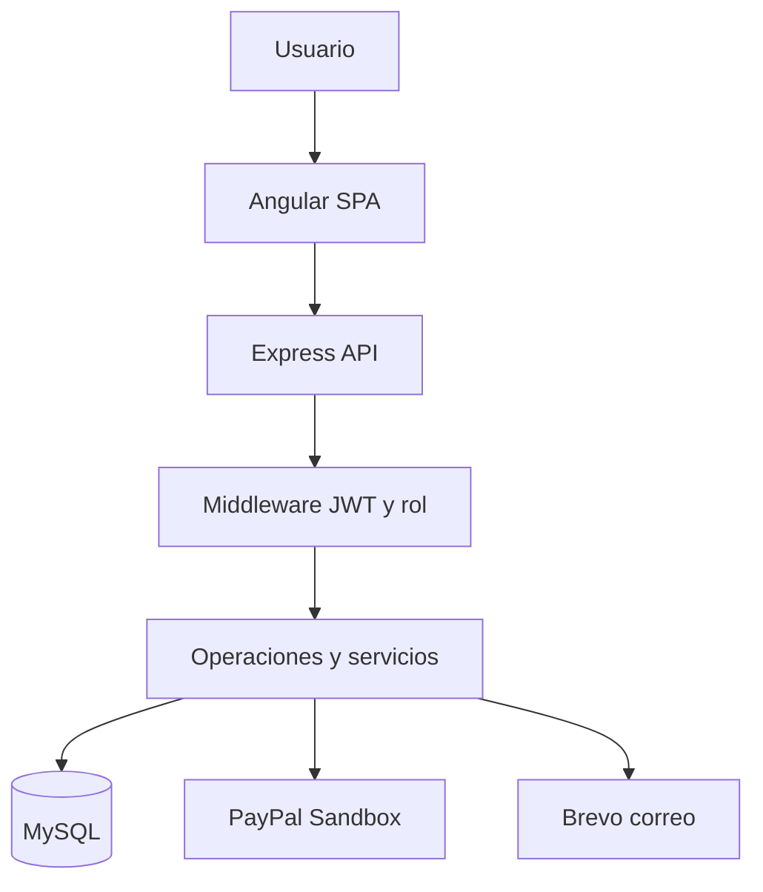

# Especificación de requisitos de software

## CoffeERP · Versión simplificada para examen

**Institución:** CETI Colomos · Desarrollo de Software  
**Asignatura:** Programación Web II  
**Docente:** Paola Fernanda Ponce Villalvazo  
**Alumno:** Santiago Gallardo Ruvalcaba  
**Matrícula:** 23300748 · Grupo 7A1  
**Fecha:** 19 de octubre de 2026 · Entrega solicitada: 30 de octubre de 2026  
**Versión:** 2.0

## 1. Propósito

Definir los requisitos verificables de un ERP web académico para una cafetería. Centraliza ventas, compras, inventario, recursos humanos y movimientos financieros. La solución incluye autenticación, autorización con middleware y consumo de APIs externas de PayPal y correo para adjuntar facturas XML.

Este SRS reemplaza el alcance extenso del documento anterior para esta versión del examen. La reducción responde a la solicitud del alumno de mantener los cinco módulos de la consigna con una operación sencilla. No supone que la docente haya aprobado cada exclusión; si exige expresamente un requisito del documento anterior, deberá reincorporarse como cambio de alcance.

## 2. Alcance y exclusiones

El sistema tiene una pantalla por módulo, login y navegación compartida. Los datos persisten en MySQL; el navegador conserva únicamente el token de sesión por pestaña. El inventario gestiona unidades enteras de productos terminados.

| Módulo                  | Operaciones incluidas                                                                               |
| ----------------------- | --------------------------------------------------------------------------------------------------- |
| Finanzas y contabilidad | Libro de ingresos/egresos, movimientos manuales y saldo; integración con ventas, compras y nómina   |
| Compras y proveedores   | Registrar y consultar proveedores; registrar compra recibida y pagada; entrada automática y egreso  |
| Ventas                  | Carrito, cobro en efectivo o PayPal Sandbox, historial, verificación del pago, factura XML y correo |
| Recursos humanos        | Registrar/editar empleados, baja lógica y salario mensual pagado; alta de cuentas por administrador |
| Inventario              | Registrar/editar productos, baja lógica, mínimos, consulta de stock y movimientos con motivo        |

Quedan fuera: dashboards, presupuestos, cuentas por cobrar/pagar, pólizas y doble partida, declaraciones fiscales, CFDI, recetas de ingredientes, varias sucursales, devoluciones, vacaciones, asistencia, reportes independientes, editor de roles y exportaciones PDF/Excel. Las compras no tienen flujo de autorización: se registran al recibirlas y pagarlas. La nómina representa un salario mensual sin cálculo de ISR, IMSS ni prestaciones.

## 3. Actores y permisos

| Actor                    | Permisos                                                                                         |
| ------------------------ | ------------------------------------------------------------------------------------------------ |
| Administrador            | Acceso a cinco módulos, todas las ventas, facturas y creación de cuentas                         |
| Cajero                   | Consultar productos para vender, crear ventas y consultar/verificar sus propios pagos y facturas |
| PayPal Sandbox           | Crear órdenes, obtener su estado y confirmar capturas                                            |
| Servicio de correo Brevo | Recibir solicitud de correo con XML adjunto y devolver aceptación o error                        |

No existe registro público de usuarios. El administrador inicial se crea desde configuración local; las demás cuentas se crean en RRHH. El expediente de un empleado y su cuenta de acceso son registros independientes.

## 4. Requisitos funcionales

### Seguridad

| ID    | Requisito y aceptación                                                                                                                   |
| ----- | ---------------------------------------------------------------------------------------------------------------------------------------- |
| RF-01 | Iniciar sesión con correo y contraseña. Credenciales inválidas devuelven 401; válidas devuelven JWT y perfil sin contraseña.             |
| RF-02 | Verificar JWT firmado y con expiración de una hora mediante middleware en cada ruta de negocio. Sin sesión o token vencido devuelve 401. |
| RF-03 | Comprobar rol en backend. Un cajero recibe 403 en compras, inventario administrativo, RRHH y finanzas.                                   |
| RF-04 | Guardar contraseñas con hash bcrypt. El alta exige 10-72 caracteres, mayúscula, número y símbolo; solo ADMIN crea cuentas.               |
| RF-05 | Proteger cada venta y factura por propietario, salvo ADMIN. El acceso a una venta ajena devuelve 403.                                    |

### Inventario

| ID    | Requisito y aceptación                                                                                                                                                |
| ----- | --------------------------------------------------------------------------------------------------------------------------------------------------------------------- |
| RF-06 | Registrar y editar productos con nombre, precio positivo en centavos, mínimo entero no negativo y estado activo/inactivo.                                             |
| RF-07 | Consultar existencia, cantidad reservada y disponible. Disponible equivale a existencia menos reservado.                                                              |
| RF-08 | Registrar ajustes con cantidad entera distinta de cero y motivo obligatorio. Una salida que afecte stock reservado o produzca existencia negativa se rechaza con 409. |
| RF-09 | Mostrar alerta de stock bajo cuando disponible sea menor o igual al mínimo e historial de movimientos.                                                                |

### Compras y proveedores

| ID    | Requisito y aceptación                                                                                                                                 |
| ----- | ------------------------------------------------------------------------------------------------------------------------------------------------------ |
| RF-10 | Registrar y consultar proveedores con nombre, correo válido y teléfono.                                                                                |
| RF-11 | Registrar compra de producto activo, cantidad entera entre 1 y 100 y costo positivo. El total se calcula en servidor.                                  |
| RF-12 | Confirmar en una transacción la compra, sus detalles, la entrada de stock y el egreso financiero. Si una parte falla, no debe quedar registro parcial. |

### Ventas y servicios externos

| ID    | Requisito y aceptación                                                                                                                                                                  |
| ----- | --------------------------------------------------------------------------------------------------------------------------------------------------------------------------------------- |
| RF-13 | Crear carrito con uno o más productos activos, cantidades de 1 a 100, nombre del cliente y correo válido. El servidor obtiene los precios de SQL.                                       |
| RF-14 | Registrar cobro en efectivo confirmado por el cajero. La venta pagada descuenta inventario y genera un ingreso una sola vez.                                                            |
| RF-15 | Crear orden PayPal Sandbox usando OAuth desde backend y SDK v6 en frontend. Reservar existencias antes de crear la orden.                                                               |
| RF-16 | Capturar y verificar ID de orden, estado COMPLETED, moneda MXN e importe exacto; rechazar capturas pendientes o importes distintos.                                                     |
| RF-17 | Persistir ventas y órdenes en SQL. Ante respuesta incierta, conservar estado REVISION y permitir Verificar pago sin duplicar ingreso ni movimientos.                                    |
| RF-18 | Cancelar una reserva no pagada comprobando el estado remoto si existe orden. No liberar automáticamente pagos aprobados o inciertos.                                                    |
| RF-19 | Generar factura XML académica únicamente para venta pagada, incluyendo folio, fecha, emisor, cliente, productos, cantidades, precios históricos, moneda y pago. Escapar caracteres XML. |
| RF-20 | Intentar envío automático mediante API de Brevo con XML base64 adjunto. Si falla, mantener venta pagada, permitir descargar y reintentar el correo.                                     |
| RF-21 | Mostrar historial con estado de pago y correo. ENVIADA representa aceptación del proveedor, no confirmación de lectura o entrega.                                                       |

### Recursos humanos

| ID    | Requisito y aceptación                                                                                                                             |
| ----- | -------------------------------------------------------------------------------------------------------------------------------------------------- |
| RF-22 | Registrar/editar nombre, puesto, correo, salario mensual positivo y estado del empleado. La baja es lógica.                                        |
| RF-23 | Registrar salario pagado por empleado y periodo AAAA-MM. Impedir duplicar el mismo empleado/mes y crear egreso financiero en la misma transacción. |

### Finanzas y uso general

| ID    | Requisito y aceptación                                                                                                                  |
| ----- | --------------------------------------------------------------------------------------------------------------------------------------- |
| RF-24 | Consultar libro de ingresos y egresos integrado y registrar movimientos manuales con concepto e importe positivo.                       |
| RF-25 | Calcular ingresos, egresos y diferencia sobre todo el historial. Presentar la diferencia como saldo de movimientos, no utilidad fiscal. |
| RF-26 | Ofrecer navegación única, mensajes de error y botones bloqueados durante operaciones; cinco pantallas sin dashboards duplicados.        |

## 5. Requisitos no funcionales

| ID     | Requisito                                                                           | Verificación                                |
| ------ | ----------------------------------------------------------------------------------- | ------------------------------------------- |
| RNF-01 | Interfaz usable a 390px y en escritorio, con tablas desplazables                    | Capturas y revisión de desbordamiento       |
| RNF-02 | Validación de entrada en servidor, consultas parametrizadas y límites de tamaño     | Pruebas HTTP y revisión del código          |
| RNF-03 | Secretos solo en entorno; hash y JWT nunca se incluyen en evidencias                | Revisión de archivos versionados            |
| RNF-04 | Persistencia e integridad referencial en InnoDB                                     | Pruebas sobre SQL real                      |
| RNF-05 | Código dividido en componentes, servicios y middleware, con comentarios y README    | Lectura de arquitectura y compilación       |
| RNF-06 | Errores de APIs externas visibles sin convertir pagos inciertos en fallidos         | Pruebas controladas de pérdida de respuesta |
| RNF-07 | Compilación de producción sin errores y pruebas reproducibles en CI                 | npm run build y GitHub Actions              |
| RNF-08 | Tiempos de espera de 15-20 segundos para APIs externas; no bloquear indefinidamente | Configuración AbortSignal.timeout           |

No se declara un SLA ni rendimiento bajo carga: no se ha realizado una prueba de estrés. CORS delimita el origen permitido; la autorización depende de JWT y roles, no de CORS.

## 6. Casos de uso esenciales

| Caso                         | Actor               | Flujo y resultado                                                                                   |
| ---------------------------- | ------------------- | --------------------------------------------------------------------------------------------------- |
| CU-01 Acceder                | Todos los usuarios  | Ingresar credenciales → verificar hash → obtener sesión → navegar según rol                         |
| CU-02 Administrar inventario | ADMIN               | Registrar producto → ajustar stock con motivo → consultar disponible y mínimo                       |
| CU-03 Recibir compra         | ADMIN               | Elegir proveedor y producto → registrar costo/cantidad → persistir compra, entrada y egreso         |
| CU-04 Cobrar venta           | ADMIN o CAJERO      | Carrito → cliente/correo → efectivo o PayPal → verificar → descontar stock y registrar ingreso      |
| CU-05 Recuperar pago         | Propietario o ADMIN | Abrir historial → Verificar pago → consultar proveedor → confirmar una sola vez o mantener revisión |
| CU-06 Entregar factura       | Propietario o ADMIN | Pago confirmado → generar XML → enviar correo; ante error, descargar o reintentar                   |
| CU-07 Administrar equipo     | ADMIN               | Registrar/editar empleado → seleccionar periodo → registrar salario y egreso                        |
| CU-08 Consultar finanzas     | ADMIN               | Consultar ingresos/egresos/saldo → añadir otro movimiento si corresponde                            |

Precondición general: sesión válida, salvo login. Los casos con API externa necesitan credenciales y conectividad. Errores de validación no deben guardar cambios parciales. No se considera finalizada una venta PayPal hasta comprobar la captura.

## 7. Arquitectura y datos

Angular funciona como SPA y consume una API REST Express. HttpClient centraliza la comunicación; un interceptor adjunta JWT solo a rutas locales `/api`. Los guards controlan navegación. Express valida sesión, permisos y datos antes de ejecutar operaciones SQL o servicios externos.

| Entidad                    | Datos principales                                                                    | Relación                                             |
| -------------------------- | ------------------------------------------------------------------------------------ | ---------------------------------------------------- |
| users                      | nombre, correo, hash, rol, activo                                                    | Un usuario origina varias ventas                     |
| products                   | nombre, precio, stock, reservado, mínimo, activo                                     | Participa en compras, ventas y movimientos           |
| suppliers                  | nombre, correo, teléfono                                                             | Un proveedor tiene varias compras                    |
| purchases / purchase_items | proveedor, total; producto, cantidad, costo                                          | Cabecera con uno o más detalles                      |
| sales / sale_items         | usuario, cliente, total, estado, método, PayPal/captura; producto y precio histórico | Venta con detalles; IDs externos únicos              |
| stock_movements            | producto, cantidad firmada, motivo, fecha                                            | Bitácora de entradas y salidas                       |
| employees / payroll        | expediente y salario; empleado, mes, pagado                                          | Único salario registrado por empleado y periodo      |
| ledger                     | tipo, concepto, importe, referencia, fecha                                           | Una referencia automática genera un único movimiento |

Los precios, costos, salarios e importes se guardan en centavos enteros. Las ventas conservan copia del nombre y precio de cada producto para que una edición posterior del catálogo no modifique su factura histórica.

## 8. Reglas de negocio

1. Los productos vendidos son unidades terminadas; no se convierten gramos/litros ni se descuentan recetas.
2. Una compra se considera recibida y pagada en el momento de su registro.
3. El stock reservado no está disponible para otra venta ni para una salida manual.
4. El precio enviado por el navegador no es una fuente de verdad para cobrar.
5. Una captura incierta no implica que el pago haya fallado. Se consulta antes de repetir.
6. Solo una venta pagada genera factura y movimiento de ingreso.
7. La factura XML es un comprobante académico sin validez fiscal ni timbrado SAT.
8. El fallo del correo no revierte el pago. El reintento puede duplicar un correo si hubo aceptación previa con respuesta perdida.
9. Los productos y empleados se desactivan; no se borran registros referenciados.
10. Los listados operativos muestran hasta 200 registros; finanzas calcula totales sobre toda la tabla.

## 9. Trazabilidad de la consigna

| Solicitud de la docente     | Requisitos / implementación            | Evidencia                                                     |
| --------------------------- | -------------------------------------- | ------------------------------------------------------------- |
| Página funcional            | RF-06 a RF-26; Angular + Express + SQL | Capturas de módulos y prueba de navegador                     |
| Finanzas y contabilidad     | RF-24, RF-25; ledger                   | Captura de finanzas                                           |
| Compras y proveedores       | RF-10 a RF-12                          | Compra persistida + movimientos                               |
| Ventas                      | RF-13 a RF-21                          | Carrito, venta e historial                                    |
| RRHH                        | RF-22, RF-23                           | Expediente y pago mensual                                     |
| Inventario                  | RF-06 a RF-09                          | Existencias y bitácora                                        |
| Seguridad con middleware    | RF-01 a RF-05                          | Pruebas 401/403, JWT y bcrypt                                 |
| PayPal                      | RF-15 a RF-18                          | Pruebas controladas; pendiente comprobación Sandbox externa   |
| Correo con factura XML      | RF-19 a RF-21                          | XML real local y prueba controlada; pendiente entrega externa |
| SRS, repositorio y capturas | Este documento, rama Git y evidencias  | Archivos en docs y GitHub                                     |

## 10. Plan de aceptación y estado de verificación

Se ejecutaron pruebas unitarias y de integración con Express y MariaDB reales para login, roles, compra/inventario, precios del servidor, venta en efectivo, XML, nómina única y efectos financieros. Los proveedores externos se sustituyeron por respuestas controladas para comprobar rechazo de importe, pérdida de respuesta de captura, reintento sin duplicar efectos y envío XML base64.

La compilación Angular se comprobó. Las capturas y el informe de navegador documentan la ejecución local con datos ficticios. No se afirma que PayPal ni Brevo hayan procesado una operación externa: faltan las claves de la aplicación y un destinatario de prueba autorizado.

Para aceptación externa: configurar Sandbox, pagar con comprador de prueba, guardar evidencia de captura COMPLETED; configurar remitente Brevo, usar un correo propio, guardar el correo recibido con XML adjunto y comprobar coincidencia de total y folio. Conservar credenciales y datos personales fuera de las capturas.

## 11. Instalación y entrega

Seguir el README principal: crear base nueva, configurar `.env`, instalar dependencias, ejecutar `npm run init-db`, iniciar backend y Angular. Las guías de cada carpeta explican arquitectura y contratos. La guía `docs/ENTREGA.md` reúne los archivos y los pasos pendientes de servicios externos.

## 12. Referencias

- Consigna del examen publicada el 16 de octubre de 2026, proporcionada por el alumno.
- Documento anterior 23300748_Examen_SistemaERP (1).pdf, antecedente de alcance y diseño.
- Apuntes local-repo-converted (6).md y (7).md; proyecto Autenticacion-Autorizacion_Angular-main.zip.
- PayPal SDK v6: https://developer.paypal.com/sdk/js/set-up/
- PayPal Orders API: https://developer.paypal.com/api/rest/integration/orders-api
- Brevo correo transaccional: https://developers.brevo.com/reference/send-transac-email
